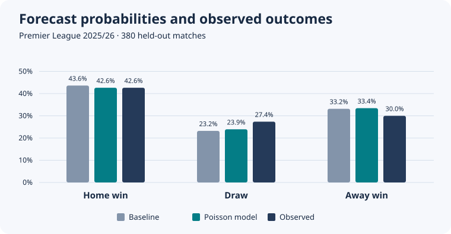

# Forecasting Premier League match outcomes

Can recent scoring and conceding history improve pre-match probabilities for a home win, draw, or away win? This project backtests a Poisson goals model against a running league-frequency baseline on **2,660 matches** across seven completed Premier League seasons.

## Results

On **380 held-out matches in 2025/26**, the model lowered log loss by **4.7%** relative to the baseline. The improvement was uneven. Draws accounted for 27.4% of matches, but the model assigned them an average probability of 23.9% and never ranked a draw as the most likely outcome.

| Model | Log loss ↓ | Multiclass Brier ↓ | Accuracy ↑ |
| --- | ---: | ---: | ---: |
| Running outcome frequencies | 1.0846 | 0.6563 | 42.6% |
| Rolling Poisson goals | **1.0336** | **0.6218** | **48.2%** |



Log loss is the primary metric because the deliverable is a set of probabilities. A confident wrong prediction costs more than an uncertain wrong prediction. The Brier score is the mean sum of squared errors across the three outcome probabilities. Accuracy uses the most probable outcome.

For example, before Liverpool hosted Bournemouth on 15 August 2025, the model assigned probabilities of **58.7% home win**, **21.3% draw**, and **20.0% away win**. The baseline gave Liverpool a 43.5% chance of winning. Liverpool won 4–2. The season-level scores above measure how well that approach worked across all fixtures.

## Reproduce the analysis

Use **Python 3.12**. The project uses the standard library, so there are no packages to install. Internet access is needed on the first run to download the public CSVs. Run the commands from the project folder.

Clone the repository, then open the project folder in VS Code or your terminal.

```bash
git clone https://github.com/tziritasnik/premier-league-forecast.git
cd premier-league-forecast
```

**Windows PowerShell or VS Code terminal**

```powershell
py -3.12 -m unittest -v
py -3.12 forecast.py
```

**macOS or Linux**

```bash
python3.12 -m unittest -v
python3.12 forecast.py
```

If your Python 3.12 executable is named `python`, use that name in the commands. You can rerun the pipeline offline after the first successful download. To use manually downloaded CSVs, name them `1920.csv` through `2526.csv` using the season codes listed in [Data and methodology](docs/methodology.md), then pass `--cache path/to/csv-folder`.

| File | Purpose |
| --- | --- |
| [forecast.py](forecast.py) | Download and validate data, generate forecasts, evaluate and write reports |
| [test_forecast.py](test_forecast.py) | Test probability math, metrics, and the same-day leakage guard |
| [reports/metrics.json](reports/metrics.json) | Validation scores, test results, source URLs, and input hashes from the reference run |
| [reports/outcomes.svg](reports/outcomes.svg) | Predicted and observed outcome frequencies |
| `reports/predictions.csv` | Generated match-by-match probabilities and outcomes |
| [docs/methodology.md](docs/methodology.md) | Data dictionary, backtest design, and limitations |

## How the backtest works

1. Build team and league histories from 2019/20 through 2023/24.
2. Compare four lookback windows in 2024/25 using log loss. The 38-match window scored best among the tested settings.
3. Freeze that choice and evaluate 2025/26. Predict every fixture on a date before adding any results from that date to either model’s history.

The model assumes independent team goal counts. A club’s older matches can carry over across seasons, and clubs with little Premier League history rely more on the league prior. The comparison uses one held-out season and a simple baseline, so it supports a limited claim about this dataset and evaluation protocol.

Match data comes from [Football-Data.co.uk’s England results archive](https://www.football-data.co.uk/englandm.php).

[Repository maintenance and GitHub Actions](docs/github.md)
